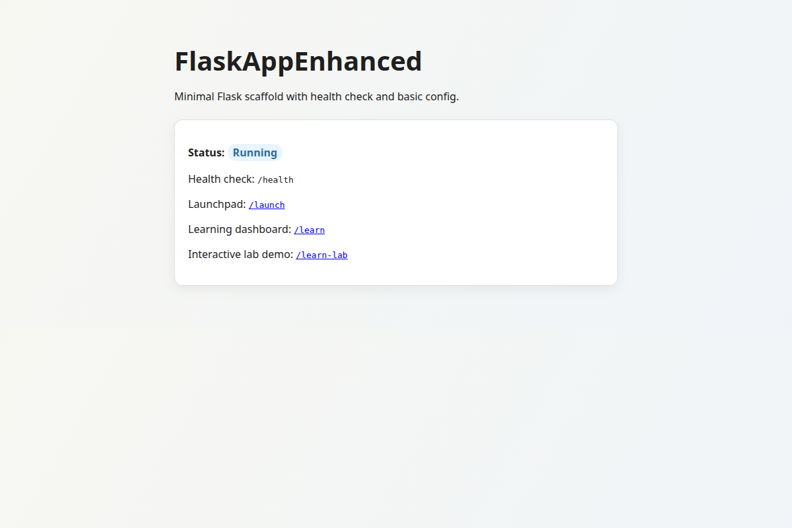

# FlaskAppEnhanced

Personal portfolio project showing support engineering, QA, tooling, and automation: a small Flask service with health checks, request logs, safe defaults, tests, and GitHub Actions.

[](https://github.com/dkupratis-debug/FlaskAppEnhanced/actions/workflows/ci.yml)

## Features

- `GET /` is the home page. `GET /learn`, `GET /learn-lab`, and `GET /launch` are learning pages. Progress stays in the browser under the `localStorage` keys `flaskappenhanced-learning-progress` and `flaskappenhanced-learn-lab-progress`. There is no database.
- `GET /health` returns JSON `{"status": "ok"}` and is exempt from rate limits.
- `GET /submit` shows a name form with a CSRF token. A browser post redirects back to the form and shows `Thanks, {name}.` A blank name becomes `anonymous`. Clients that do not prefer HTML, including default `curl` (`Accept: */*`), get JSON `{"message": "Thanks, {name}."}` instead. A missing or invalid CSRF token returns HTTP 400.
- `POST /api/echo` is exempt from CSRF, limited to 30 requests per minute, and returns the JSON body as `{"received": ...}`.
- Default rate limits are 200 per day and 50 per hour, with `X-RateLimit-*` headers. Storage defaults to `memory://`.
- Responses set `X-Content-Type-Options: nosniff`, `X-Frame-Options: DENY`, `Referrer-Policy: no-referrer`, and `Content-Security-Policy` (default `default-src 'self'`). Each response also sets `X-Request-Id` from the incoming header, or a new UUID. Access logs are one JSON object per request, with method, path, status, duration, and remote address. With `TRUST_PROXY_COUNT` at 0, a client-supplied `X-Forwarded-For` is not copied into the log.
- When `FLASK_ENV=production`, startup raises `RuntimeError` if `SECRET_KEY` is empty or still `dev-not-secret`.

## Screenshot

Home page from the local development server (`python app.py` at `http://127.0.0.1:5000`):



## Setup

Python 3.10 or newer. These commands were run with Python 3.12.3.

```bash
python3 -m venv venv
source venv/bin/activate
python -m pip install -r requirements.txt
python app.py
```

The development server listens on `http://127.0.0.1:5000` with debug mode on, because `DevelopmentConfig` sets `DEBUG`. It is the Werkzeug development server, not a production deployment.

```bash
curl -sS http://127.0.0.1:5000/health
```

That request returned HTTP 200 and JSON `{"status": "ok"}`. With debug mode on, Flask pretty-prints the body.

Copy `.env.example` to `.env` only when you want local overrides. `app.py` loads `.env` when python-dotenv imports. Loading the example file sets `FLASK_ENV=development` and `SECRET_KEY` to the placeholder `change-me`. `.env` is gitignored. Do not commit it.

| Variable | Default | Role |
| --- | --- | --- |
| `FLASK_ENV` | `development` | `production` selects production settings |
| `SECRET_KEY` | `dev-not-secret` | Empty or `dev-not-secret` aborts production startup |
| `RATELIMIT_DEFAULT` | `200 per day;50 per hour` | Flask-Limiter defaults |
| `RATELIMIT_STORAGE_URI` | `memory://` | Limiter storage. Production logs a warning to use Redis while this stays in memory |
| `TRUST_PROXY_COUNT` | `0` | Values above 0 enable ProxyFix and log `X-Forwarded-For` when that header is present |
| `CONTENT_SECURITY_POLICY` | `default-src 'self'` | CSP response header |
| `LOG_FILE` | unset | Rotating file log. Otherwise logs go to stderr |

Production, run here with gunicorn 22.0.0. `/health` returned `{"status":"ok"}`. The same launch without `SECRET_KEY` exited with `RuntimeError`.

```bash
export FLASK_ENV=production
export SECRET_KEY=change-me
export GUNICORN_BIND=127.0.0.1:8000
gunicorn -c gunicorn.conf.py wsgi:app
```

`change-me` is the placeholder in `.env.example`. Replace it before any shared or public deployment. Production startup only rejects an empty key and `dev-not-secret`. `gunicorn.conf.py` uses `0.0.0.0:8000`, 2 workers, and 2 threads when the `GUNICORN_*` variables are unset. With `memory://` storage, each worker logs a warning to use Redis so limits stay accurate across processes.

`make test` and `make lint` passed. They call the venv Python directly. `make prod` sets `FLASK_ENV=production` and does not set `SECRET_KEY`. `tasks.ps1` has `install`, `dev`, `test`, `lint`, `run`, and `prod` for PowerShell. It was not run here. Its `prod` task has the same `SECRET_KEY` gap.

## Tests

Install the dev requirements, then run the same checks as the CI test job:

```bash
python -m pip install -r requirements-dev.txt
pytest
ruff check .
```

On Python 3.12.3, `pytest` reported 16 passed and `ruff check .` reported all checks passed. `pyproject.toml` adds `-q` and disables the pytest cache provider. Tests live in `tests/test_app.py` and use Flask's test client. They do not cover rate-limit exhaustion.

The docs audit from `.github/workflows/docs_quality.yml` also passed:

```bash
python tools/docs_audit.py
```

## Tech stack

- Python `>=3.10` (`pyproject.toml`). The CI test job uses Python 3.11. The docs audit workflow uses Python 3.12. The commands above were run with Python 3.12.3.
- Runtime (`requirements.txt`): Flask 3.1.3, Flask-WTF 1.2.1, Flask-Limiter 3.8.0, gunicorn 22.0.0, python-dotenv 1.2.2.
- Development (`requirements-dev.txt`): pytest 9.0.3, ruff 0.9.6, build 1.2.2.post1, pre-commit 3.8.0.
- Jinja templates and one stylesheet, `app/static/styles.css`.
- Package version 0.3.2 in `pyproject.toml`, with a `flaskappenhanced` console script. `app/__main__.py` calls `app.run()`.
- `Dockerfile` uses `python:3.11-slim`, sets `FLASK_ENV=production`, and starts gunicorn on port 8000. The image was not run here. The same production secret check applies, so the container needs a non-default `SECRET_KEY`. This repo does not record a live demo URL. `render.yaml` is a Render blueprint only.

## Project layout

```text
app/                  Flask package: factory, routes, templates, static CSS and JS
app/ratelimit.py      Rate-limit storage URI and the production memory warning
tests/test_app.py     Pytest suite
config.py             Development and production settings
app.py                Development entry point (loads .env, then app.run())
wsgi.py               Gunicorn entry point
gunicorn.conf.py      Bind, workers, threads, timeout
Dockerfile            Container image that starts gunicorn
render.yaml           Render blueprint
requirements.txt      Runtime dependencies
requirements-dev.txt  Test and lint dependencies
pyproject.toml        Package metadata, pytest, and ruff settings
Makefile              install, dev, test, lint, run, and prod
tasks.ps1             PowerShell tasks for those same targets
tools/docs_audit.py   Checks required docs, index links, and fenced code blocks
tools/dashboard/      Local GitHub metrics UI (see its README)
.github/workflows/    CI and other GitHub Actions workflows
docs/                 Contributor guides and troubleshooting notes (docs/INDEX.md)
```

CI (`.github/workflows/ci.yml`) runs on every push and pull request: `ruff check .` and `pytest` on Python 3.11, pre-commit, markdownlint, yamllint, and a Markdown link check.

## License

MIT. Copyright (c) 2026 David Kupratis. See [LICENSE](LICENSE).
