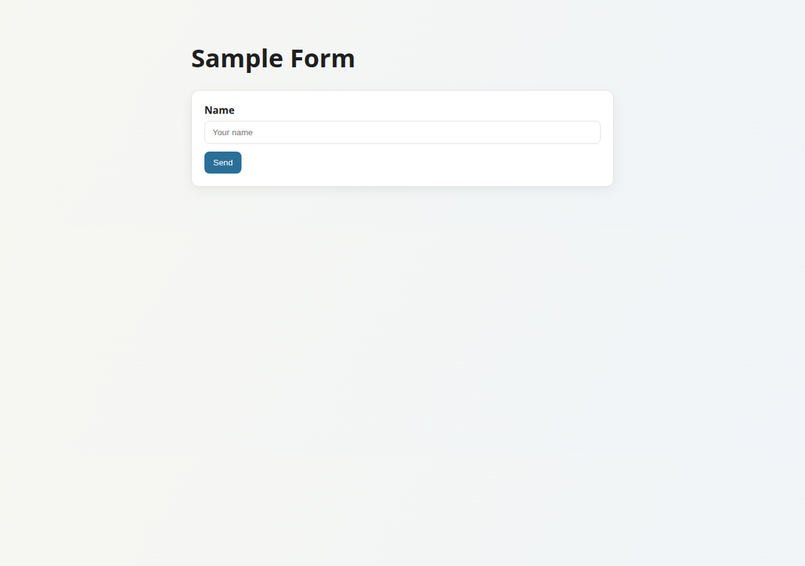
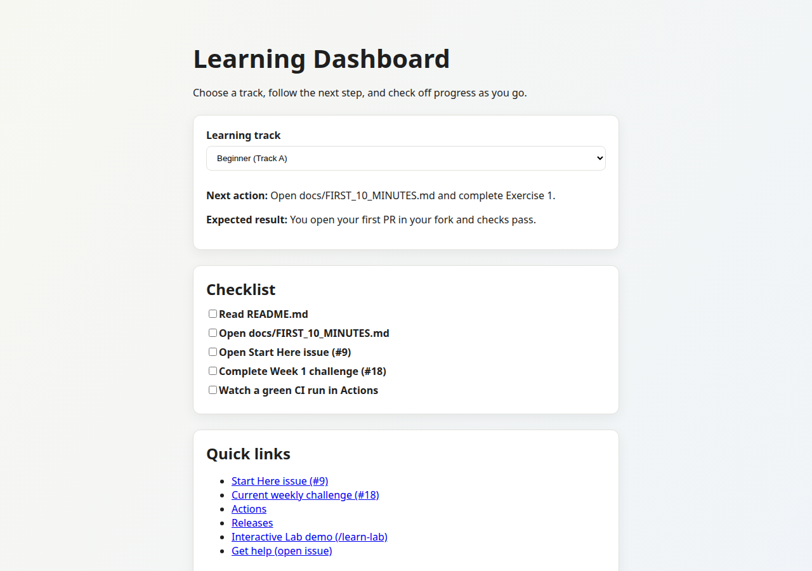

# FlaskAppEnhanced

Small Flask app for learning a minimal web service: a few HTML pages, a CSRF form, a JSON echo endpoint, structured request logs, and GitHub Actions checks.

[](https://github.com/dkupratis-debug/FlaskAppEnhanced/actions/workflows/ci.yml)
[](https://github.com/dkupratis-debug/FlaskAppEnhanced/actions/workflows/codeql.yml)
[](LICENSE)

## Features

- `GET /` renders the home page.
- `GET /health` returns JSON `{"status": "ok"}` and is exempt from rate limits.
- `GET /submit` renders a name form with a hidden CSRF token. `POST /submit` reads the form field `name` (blank becomes `anonymous`). A browser form post (Accept prefers `text/html`) redirects back to the form and shows `Thanks, {name}.` Requests that do not prefer HTML (`Accept: application/json`, `Accept: */*`, a JSON content type, or no Accept header) still get a JSON body. A form field `name=Ada` with one of those Accept values returns `{"message": "Thanks, Ada."}`.
- `POST /api/echo` is CSRF-exempt, has a route limit of `30 per minute`, and returns the JSON body as `{"received": ...}`.
- Flask-Limiter applies the default limits `200 per day` and `50 per hour`, with `X-RateLimit-*` headers. Storage defaults to `memory://`.
- Responses set `X-Content-Type-Options: nosniff`, `X-Frame-Options: DENY`, `Referrer-Policy: no-referrer`, and `Content-Security-Policy` (default `default-src 'self'`).
- Each request gets an `X-Request-Id` (incoming header or a new UUID). Access logs are one JSON object per request, with method, path, status, duration, and remote. `remote` is `remote_addr` unless `TRUST_PROXY_COUNT` is greater than 0, in which case it is the `X-Forwarded-For` value when that header is present.
- `GET /learn`, `GET /learn-lab`, and `GET /launch` render learning pages. `/learn` and `/learn-lab` load `/static/learn.js` and `/static/learn_lab.js`. Those scripts use `localStorage` keys `flaskappenhanced-learning-progress` and `flaskappenhanced-learn-lab-progress`.
- With `FLASK_ENV=production`, startup fails if `SECRET_KEY` is empty or still `dev-not-secret`.

## Tech stack

- Python `>=3.10` (`pyproject.toml`). The CI test job uses Python 3.11. The docs audit workflow uses Python 3.12. Local checks for this README used Python 3.12.3.
- Runtime (`requirements.txt`): Flask 3.1.3, Flask-WTF 1.2.1, Flask-Limiter 3.8.0, gunicorn 22.0.0, python-dotenv 1.2.2.
- Development (`requirements-dev.txt`): pytest 9.0.3, ruff 0.9.6, build 1.2.2.post1, pre-commit 3.8.0.
- Jinja templates and one stylesheet, `app/static/styles.css`.
- Package metadata and the `flaskappenhanced` console script are in `pyproject.toml` (version 0.3.2). `app/__main__.py` calls `app.run()`.
- `Dockerfile` uses `python:3.11-slim` and starts gunicorn with `FLASK_ENV=production` on port 8000. `render.yaml` is a Render blueprint. This repo does not record a live demo URL.

## Screenshots

Captured from the local development server (`python app.py` on `http://127.0.0.1:5000`).

Home page (`GET /`):


Sample form (`GET /submit`):



Learning dashboard (`GET /learn`). `/static/learn.js` fills the checklist. The default Content-Security-Policy is `default-src 'self'`, which allows that same-origin file:



## Quick start

Requires Python 3.10 or newer.

Linux or macOS (verified with Python 3.12.3):

```bash
python3 -m venv venv
source venv/bin/activate
python -m pip install -r requirements.txt
python app.py
```

The development server listens on `http://127.0.0.1:5000` with debug mode on, because `DevelopmentConfig` sets `DEBUG`. Open `/` or check health:

```bash
curl http://127.0.0.1:5000/health
```

Windows PowerShell (activation and environment variables differ; same steps as `tasks.ps1`):

```powershell
python -m venv venv
.\venv\Scripts\Activate.ps1
python -m pip install -r requirements.txt
python app.py
```

Optional configuration: copy `.env.example` to `.env`. `app.py` calls `load_dotenv()` when python-dotenv imports. Values below are the code defaults.

| Variable | Default | Role |
| --- | --- | --- |
| `FLASK_ENV` | `development` | `production` selects `ProductionConfig` |
| `SECRET_KEY` | `dev-not-secret` | Rejected when `FLASK_ENV=production` |
| `RATELIMIT_DEFAULT` | `200 per day;50 per hour` | Flask-Limiter defaults |
| `RATELIMIT_STORAGE_URI` | `memory://` | Limiter storage |
| `TRUST_PROXY_COUNT` | `0` | Enables `ProxyFix` when greater than 0 |
| `CONTENT_SECURITY_POLICY` | `default-src 'self'` | CSP response header |
| `LOG_FILE` | unset | Rotating file log; otherwise logs go to stderr |

Production config, verified with gunicorn 22.0.0. `/health` returned `{"status":"ok"}`. Without `SECRET_KEY`, process startup raises `RuntimeError`.

```bash
export FLASK_ENV=production
export SECRET_KEY=change-me
export GUNICORN_BIND=127.0.0.1:8000
gunicorn -c gunicorn.conf.py wsgi:app
```

`gunicorn.conf.py` uses `0.0.0.0:8000`, 2 workers, and 2 threads when those `GUNICORN_*` variables are unset. On startup with `memory://` storage, the app logs a warning to use Redis for accurate limits across processes.

PowerShell:

```powershell
$env:FLASK_ENV = "production"
$env:SECRET_KEY = "change-me"
$env:GUNICORN_BIND = "127.0.0.1:8000"
gunicorn -c gunicorn.conf.py wsgi:app
```

`change-me` is the placeholder in `.env.example`. It is accepted because production only rejects an empty key and `dev-not-secret`.

## Running tests

Install dev dependencies, then run the same commands as the CI test job. Verified locally on this branch: `pytest` reported 16 passed, and `ruff check .` reported all checks passed.

```bash
python -m pip install -r requirements-dev.txt
pytest
ruff check .
```

`pyproject.toml` adds `-q` and disables the pytest cache provider. Tests live in `tests/test_app.py` and use Flask's test client.

PowerShell, from `tasks.ps1` after the venv is active:

```powershell
pip install -r requirements-dev.txt
pytest
ruff check .
```

The docs audit used by CI also passed locally:

```bash
python tools/docs_audit.py
```

## Project structure

```text
app/                  Flask package: factory, routes, templates, static CSS and JS
app/ratelimit.py      Rate-limit storage URI, with a production memory warning
tests/test_app.py     Pytest suite
config.py             Development and production settings
app.py                Development entry point (loads .env, then app.run())
wsgi.py               Gunicorn entry point
gunicorn.conf.py      Bind, workers, threads, timeout
Dockerfile            Container image that starts gunicorn
render.yaml           Render blueprint
requirements.txt      Runtime dependencies
requirements-dev.txt  Test and lint dependencies
pyproject.toml        Package metadata, pytest, and ruff settings
Makefile              Cross-platform tasks; calls the venv Python directly
tasks.ps1             PowerShell tasks: install, dev, test, lint, run, prod
tools/docs_audit.py   Docs existence, index links, and fence check
tools/dashboard/      Local GitHub metrics UI (see its README)
.github/workflows/    CI, CodeQL, release, package, and repo automation
docs/                 Contributor and GitHub learning docs (docs/INDEX.md)
```

## Quality and automation

`.github/workflows/ci.yml` runs on push and pull request:

- `ruff check .` and `pytest` on Python 3.11
- `pre-commit run --all-files` (trailing whitespace, YAML check, ruff, markdownlint)
- markdownlint-cli2 on `**/*.md` using `.markdownlint.yml`
- yamllint using `.yamllint.yml`
- lychee link check on Markdown, with `.lycheeignore`

Other workflows in `.github/workflows/`:

- `codeql.yml`: CodeQL for Python on pushes and pull requests to `main`, plus a weekly schedule.
- `dependency_review.yml`: dependency review on pull requests to `main`, failing on moderate severity.
- `docs_quality.yml`: `python tools/docs_audit.py` on Python 3.12 for pushes and pull requests to `main`.
- `workflow_security.yml`: harden-runner in audit mode and actionlint, on pushes and pull requests to `main`.
- `release.yml`: on `v*` tags, checks that the tag matches `pyproject.toml`, builds a wheel and sdist, and creates a GitHub Release.
- `package.yml`: builds and pushes a GHCR image on `main`, on `v*` tags, and on manual dispatch.
- `auto_label.yml`: applies labels from `.github/labeler.yml` on pull requests.
- `first_time_contributor.yml`: posts a welcome on a first issue or pull request.
- `weekly_checkin_issue.yml`, `weekly_leaderboard.yml`, and `monthly_recap_issue.yml`: open scheduled issues (also `workflow_dispatch`).
- `playground_branch_generator.yml`: manual workflow that pushes a branch for a chosen failing check.

Ruff selects rules `E`, `F`, and `I` with a line length of 100. `Makefile` calls `venv/bin/python` on Linux and macOS and `venv\Scripts\python.exe` on Windows, so the targets do not activate a shell. `tasks.ps1` remains the PowerShell runner. `make test` and `make lint` were run on Linux against the project venv.

## Design notes

- `create_app()` picks `DevelopmentConfig` or `ProductionConfig` from `FLASK_ENV`. Session cookies are `HttpOnly` and `SameSite=Lax`. The secure flag is on only in production.
- CSRF protection is on for the app. The form posts a `csrf_token` field. `/api/echo` is marked CSRF-exempt.
- A missing or invalid CSRF token returns HTTP 400. Clients that prefer HTML get a short page; other clients get JSON `{"error": "..."}`. The request-id hook is registered before CSRF. If that hook did not run, `after_request` still sets `X-Request-Id` and writes the access log.
- The default CSP is `default-src 'self'` and does not include `unsafe-inline`. `/learn` and `/learn-lab` load scripts from `/static/`, which that policy allows.
- Request logs use `remote_addr` when `TRUST_PROXY_COUNT` is 0, so a client-supplied `X-Forwarded-For` is not copied into the log. When the count is greater than 0, the log records `X-Forwarded-For` if present, and `ProxyFix` is enabled with that hop count.
- There is no database. Learning progress is stored in the browser under the `localStorage` keys above.
- Tests cover the pages, echo payload, CSRF field, missing and invalid CSRF tokens, external learn scripts and the CSP header, proxy log handling, browser versus JSON submit responses, security headers on `/`, and the production secret check. They do not cover rate-limit exhaustion.
- Maximum request body size defaults to 1 MiB (`MAX_CONTENT_LENGTH`). CSRF tokens expire after 3600 seconds unless `WTF_CSRF_TIME_LIMIT` is set.

## License

MIT. See [LICENSE](LICENSE).
